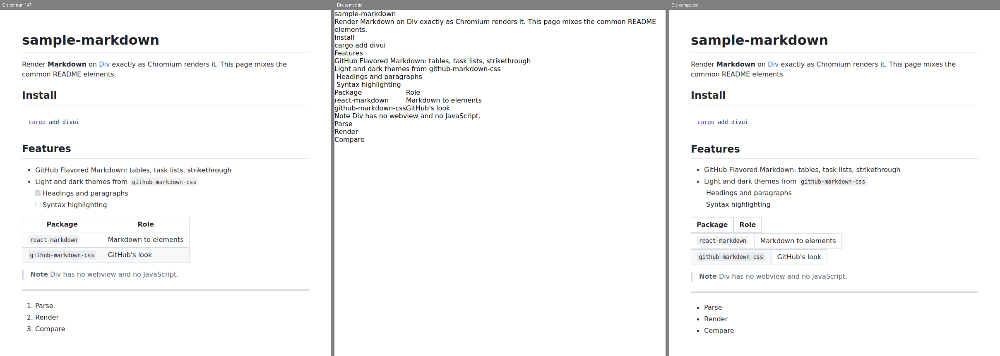

# Sample Markdown: design and phase 1 findings

Goal: show Markdown in a [Div](https://github.com/build-with-div/div) app
exactly as Chromium shows it. We don't re-create GitHub's look. We port the
web's Markdown stack by making Div implement the platform features those
packages rely on, and we measure each one against pinned Chromium.

This is the phase 1 report. Everything below was measured against Div
`565db46a` (build-with-div/div `main`, 13 November 2026) and Chrome for
Testing 147.0.7727.50 in WSL, or read from Div's source at that commit. A
rerun at the current pin, `92ea25a0`, gave the same values for every fixture,
box and block ([yardstick history](#yardstick-history)). Full
numbers: [fidelity-results.md](fidelity-results.md), generated from
[evidence/fidelity-v1.json](evidence/fidelity-v1.json). Proposed Div APIs:
[rfc-markdown.md](rfc-markdown.md). Code-level `// div-gap:` labels:
[framework-gaps.md](framework-gaps.md).

## Summary

- **Semantic mode** builds react-markdown's element tree with Div's public
  API: `Element::create`, attributes and text. Today that renders flat
  text, with no heading sizes, margins, list markers or code blocks. 0 of 48
  page renders are pixel-exact and 0 of 392 element boxes match. Div has no
  user-agent stylesheet and no author cascade, and it rejects 7 of the tags
  Markdown emits.
- **Computed mode** builds the same tree with each element's Chromium
  computed style copied in as typed declarations. This takes the cascade out
  of the comparison and isolates layout, paint and text:
  - 8 of 48 page renders are exact: blockquote and hr, light and dark, at 1x
    and 2x.
  - 214 of 392 boxes are within 1/128 px.
  - 46 of 92 top-level blocks are pixel-exact at 1x, and 34 of 92 at 2x.
- Block layout, margins, borders, `pre` with `white-space: pre`, `tab-size`
  and horizontal scrolling are close to or exactly Chromium's. These are
  wrong in computed mode:
  - **Lists:** ordered lists show bullets. Div's `list-style-type` takes
    only `none` and `disc`.
  - **Tables:** each row lays out as its own table.
  - **Strikethrough:** no `text-decoration` line is painted.
  - **Task lists:** checkboxes have a 0×0 box.
  - **Rounded corners:** `border-*-radius: 6px` is rejected.
  - **Text:** lines differ by 1/64 px with fractional font sizes, and some
    glyphs are offset.
- The rest is the platform work the user asked for: real HTML tags, a
  browser UA stylesheet (RFC 0004), class and descendant selectors (A1),
  custom properties and `prefers-color-scheme` (A2), `` loading,
  links, and document text selection.



## How the web renders Markdown

| Package | What it does | Platform features it relies on |
| --- | --- | --- |
| react-markdown 10.1.0 (remark-parse, remark-rehype) | Markdown → mdast → hast → React elements | Real HTML elements and their default rendering (UA stylesheet) |
| remark-gfm 4.0.1 | Tables, task lists, strikethrough, autolinks, footnotes | `table` layout, `input[type=checkbox]`, `del`, `sup`/`a` with `::before`/`::after` brackets, `section.footnotes` |
| rehype-raw 7.0.0 (as GitHub allows raw HTML) | Parses inline HTML: `details`, `summary`, `kbd`, `sub`, `sup`, `align`, `width` | Those elements and presentational attributes |
| github-markdown-css 5.9.0 | GitHub's look: 194 rules, 324 selectors, light and dark | Class, descendant (302), child (29) and sibling (2) selectors; `:hover`, `:focus(-visible)`, `:not`, `:has`, `:first/last/nth-child`, `:target`, `:dir`; `::before`/`::after`; 60 custom properties used 124 times; `@media (prefers-color-scheme)`; `box-shadow`, `border-radius`, `word-wrap`, `mask-image`, `clip-path` ([inventory](#css-inventory)) |
| Shiki (or Prism) | Code highlighting. Shiki runs TextMate grammars with Oniguruma and emits `<span style="color:…">`; Prism emits `token` classes styled by a theme sheet | Inline colors (Shiki); class selectors (Prism); custom properties and media for Shiki's dual themes |
| KaTeX (stretch) | TeX → HTML spans with inline em-based styles + 20 web font faces | `@font-face` (WOFF2), exact inline-block baselines, negative `vertical-align`, SVG `path` with fill for stretchy delimiters |
| Mermaid (stretch) | Diagram text → SVG, laid out by dagre in JavaScript, measuring text with `getBBox` | A JavaScript runtime and SVG text, stroke, markers and `foreignObject` labels |

In Rust, the parse step belongs to the app or component and needs nothing
from Div. comrak, a port of GitHub's cmark-gfm, produces GitHub's element
structure and class names. pulldown-cmark is faster but covers less of
GFM. Shiki's role maps to syntect, which uses the same TextMate grammars and
VS Code themes through Oniguruma, and then needs only colored spans. What Div
must provide is the rendering of that HTML and CSS.

## How it was measured

Commands and file layout are in the [README](../README.md#reproduce-the-comparison).

1. **Fixtures.** `fixtures/*.md` holds 12 small GFM documents: headings,
   inline formatting, lists, task lists, blockquote, code, table, hr,
   images, inline HTML, footnotes and a README-like page.
   `reference/build.mjs` renders each one with react-markdown + remark-gfm +
   rehype-raw (React 19 static render) inside
   `<article class="markdown-body">`. It uses github-markdown-css light or
   dark and the page style that package's readme recommends, giving 24 pages
   (`reference/pages`, rebuilt and diffed in CI).
2. **Capture.** `harness/compare.py` loads each page in pinned Chromium with
   the census real-font fontconfig, and records the `<body>` tree:
   - every element's tag, attributes, text and `getBoundingClientRect`;
   - computed longhands that differ from `all: initial`;
   - `width` and `height` as computed values, read under `display: none`,
     so `max-content` and `.25em` survive while used sizes do not;
   - the pseudo-elements that generate boxes.

   The viewport is 800 px wide and as tall as the page.
3. **Render.** `markdown-render` (Div public API only, `chromium_linux_lcd`
   raster, pinned FreeType) rebuilds the tree in two modes:
   - `semantic`: tags, attributes and text only;
   - `computed`: also each computed value through `parse_literal` +
     `set_property`.

   Tags Div rejects get a `span` or `div` stand-in. Every rejection is
   counted in a per-fixture report.
4. **Compare.** Pixels are compared exactly at 1x and 2x, for the whole page
   and for each top-level block of the article. Element boxes are compared
   within 1/128 px, Chromium's half LayoutUnit.

GitHub's font stack resolves through Fontconfig to DejaVu Sans and DejaVu
Sans Mono in this environment, the same in Chromium and in Div (Div passes
families to Fontconfig on Linux). Results are Linux only. On Windows, Div's
generic-family aliases are documented in div-text as not yet compared with
Windows Chrome.

Computed mode is measurement scaffolding, labeled `div-gap: G-CASCADE` in
the code. An app must not copy computed styles. It tells the engine track
which layout, paint and text bugs remain once the cascade exists.

## Results by element

From [fidelity-results.md](fidelity-results.md) (computed mode, 24 pages):

| Area | Boxes (1/128 px) | Pixels | What differs |
| --- | --- | --- | --- |
| Headings h1–h6 | 16/20 | h3–h5 exact at both scales; h1 exact at 2x only, h2 at 1x only | h6 (13.6 px) line box 16.984375 px in Chromium vs 17 in Div; h1 glyphs at 1x and paragraph text at 2x are offset by one device pixel |
| Paragraphs, inline | p 46/62, strong 6/10, em 4/4, code 6/20, a 10/14 | inline: 1/2 blocks exact | `del` paints no line-through; inline `code` has square corners (`border-radius: 6px` rejected); `br` 0/2 |
| Lists | ul 14/16, ol 6/8, li 48/62 | lists 1/3 blocks exact | Markers: `decimal`, `lower-roman`, `circle`, `square` rejected, so all lists show discs; `counter-increment: list-item 0` and `list-style-position: inside` rejected ([screenshot](screenshots/lists-light.png)) |
| Task lists | input 0/14 | 0/1 blocks | `<input type=checkbox>` has a 0×0 box, even with no styles at all (Chromium 13×13) ([screenshot](screenshots/tasklist-light.png)) |
| Blockquote | 4/6 | exact page, light and dark, 1x and 2x | (in the README fixture it inherits the list and text differences above it) |
| Code blocks | pre 0/8 | 0/8 blocks | Each line is 1/64 px taller (13.6 px × 1.45); rounded corners rejected. Horizontal scrolling of the long line works, with a scrollbar at the same place ([screenshot](screenshots/code-light.png)) |
| Tables | table 0/4, cells and rows 0/54 | 0/4 blocks | github-markdown-css makes `table` `display: block; width: max-content`. `max-content` is rejected, and the row groups do not share columns: each row is sized alone and borders do not collapse ([screenshot](screenshots/table-light.png)) |
| hr | 4/6 | exact | (after the capture kept `height: .25em`) |
| Images | img 2/4 | image: 1/4 blocks | Works only through `register_image_resource` + `set_image_resource` with the size passed in. Without a size the box is 300×150. A paragraph holding an image is 0.5 px shorter (86.5 vs 87) |
| details/summary | 4/4, summary 4/4 | 0/4 blocks | The disclosure triangle is a disc: `disclosure-open/closed` exist in Div's enum, but the literal parser rejects them ([screenshot](screenshots/html-light.png)) |
| sup/sub/kbd | sup 2/6, sub 2/2, kbd 4/4 | – | Footnote references lack the `[`/`]` that `::before`/`::after` add, so they are narrower |

In semantic mode nothing matches (0/392 boxes): every element is unstyled
inline or block text ([screenshots](screenshots/)).

## Gap inventory

Owners are the Div tracks:
- **engine:** div-style, div-layout, div-paint, div-text, div-engine.
- **framework:** divui, div-platform, div-macros.
- **components:** div-components.

Sizes:
- **S:** one small PR.
- **M:** a focused series.
- **L:** a workstream.

"Measured" means this repository's harness shows it. "Read" means it was
read from Div's source.

| # | Package → platform feature | Div today | Missing | Owner | Size |
| --- | --- | --- | --- | --- | --- |
| MD-1 | all → HTML element identity | Measured: `Element::create` rejects `blockquote`, `pre`, `code`, `del`, `kbd`, `sub`, `sup` (`UnknownTag`). Read: also `s`, `b`, `i`, `ins`, `mark`, `dl`/`dt`/`dd`, `abbr`, `q`, `samp`, `var`, `figure`, `picture`. `h1`–`h6`, `p`, `ul`, `ol`, `hr` become `Div` with no name kept | Every element GitHub's sanitizer allows, with its local name kept for selectors and accessibility ([RFC 0004](https://github.com/build-with-div/div/blob/main/docs/alpha/rfcs/0004-style-presets.md) prerequisite 1) | framework (`tag_definition`, `view!`) + engine (`LocalName` in div-dom) | M |
| MD-2 | all → `html`/`body` pair | Measured: `Document::body()` is the root. Given Chromium's body style (8 px margin) it still lays out at 0,0 800×600 | A root `html` with `body` inside it, so the UA `body { margin: 8px }` and root background propagation work | engine + framework | M |
| MD-3 | react-markdown → UA stylesheet | Measured: semantic mode 0/392 boxes. Read: RFC 0004 proposed, not started | The browser preset's text, sections, lists and tables parts first: these are what Markdown uses | engine | L |
| MD-4 | github-markdown-css → selectors and cascade | Read: A1 in progress (`style!` done; `css!`, `stylesheet!` next). RFC 0001 makes unsupported selectors compile errors | `stylesheet!` over the npm file. Descendant, child and sibling combinators; attribute selectors; `:hover`, `:focus-visible`, `:not`, `:has`, `:first/last/nth-child`, `:target`, `:dir`. A browser-compatible mode for third-party sheets that drops what Chromium drops (10 vendor pseudo-elements, `-ms-`/`-webkit-` properties) and reports it ([RFC](rfc-markdown.md#3-third-party-stylesheets)) | engine (A1) | L |
| MD-5 | github-markdown-css → custom properties | Read: none (A2 tokens planned) | 60 tokens, 124 `var()` uses, swapped by `[data-theme]` or the color scheme | engine (A2) | M |
| MD-6 | github-markdown-css → media | Read: none (A2) | `prefers-color-scheme`, `max-width: 767px`; the framework follows the OS theme (`Document::set_color_scheme` in RFC 0001) | engine (A2) + framework | M |
| MD-7 | lists → markers and counters | Measured: `list-style-type` takes `none` and `disc` only; `counter-increment: list-item 0` and `list-style-position: inside` rejected | `decimal`, `lower-roman`, `circle`, `square` (and the rest of CSS Counter Styles' predefined set Chromium has), `ol start`/`reversed`/`li value`, the `list-item` counter, `inside` markers | engine | M |
| MD-8 | GFM tables → table layout | Measured: `table` with `display: block` (github-markdown-css) has row groups that do not share columns; `width: max-content` rejected; collapsed borders differ | Anonymous table wrapping as in CSS 2 §17.2.1 and Chromium; `max-content`/`min-content`/`fit-content` sizes; `border-collapse` painting | engine | L |
| MD-9 | `del`, links → text decoration | Measured: `text-decoration-line: line-through` or `underline` through `set_property` paints no line on an inline span or a block (`out/probe` td-*) | Painting of text decoration lines | engine | S–M |
| MD-10 | github-markdown-css → value literals | Measured: `border-*-radius: 6px` (single value; 128 declarations), `border-*-width: 1px` (needs a bare integer), `list-style-type` named `list-style` in `from_css_name`, `overflow-clip-margin: content-box`. Not in the schema: `appearance`, `color-scheme`, `caret-color`, logical longhands, `text-size-adjust` | Each accepted as Chromium accepts it | engine | S each |
| MD-11 | task lists → checkbox | Measured: `<input type=checkbox>` is 0×0; `type=text` is 200×19 in a 200 px viewport | Native control metrics without author styles (RFC 0004 prerequisite 3) | engine | M |
| MD-12 | all text → line metrics and glyph position | Measured: line box 1/64 px off at 13.6 px (h6, code); h1 (32 px, weight 600) glyphs differ at 1x; text 1 device px lower at 2x in some paragraphs | Match Chromium's LayoutUnit snapping of line height and glyph origins; cause not yet isolated | engine (text) | M |
| MD-13 | footnotes, clearfix → `::before`/`::after` | Read: `set_pseudo_style` covers first-line, first-letter, marker and placeholder only | Generated content from stylesheets (comes with A1 sheets); a public target for before/after | engine (A1) | S after A1 |
| MD-14 | details → disclosure marker | Measured: `disclosure-open`/`-closed` rejected by the literal parser, though the enum has them | Parse them; the UA preset gives `summary` its marker | engine | S |
| MD-15 | images → `` | Measured: setting `src` loads nothing; the app must register bytes and pass the intrinsic size, otherwise 300×150. Read: static SVG draws only `<rect>` (components track finding) | `src` resolved through the document's resource provider with a base URL; size from the decoded bytes; async remote loading; SVG paths, strokes and text | framework + engine (paint) | M (+L for SVG) |
| MD-16 | all → text selection and copy | Read: `copy_selection` copies only from the focused form control; no document selection | Selection across elements (drag, double and triple click, Ctrl+A), `::selection` paint, `user-select`, copy as text | engine + framework | L |
| MD-17 | links → navigation | Read: `a` is a plain `Span`: no focus, activation, cursor or `href` handling; no API to open a URL externally | `a[href]` semantics, a navigation callback, fragment scroll and `:target`, `open_url` on Windows and Linux | framework + platform + engine | M |
| MD-18 | GitHub raw HTML → presentational attributes | Read: none | `align` on `p`/`div`/`img`/headings, `width`/`height` on `img` (GitHub strips `style`, so no runtime CSS is needed for parity) | engine (UA preset) | S |
| MD-19 | the component | – | A `div-markdown` crate: comrak → real elements → `github-markdown-css` compiled by `stylesheet!` ([API](#recommended-component-api)) | components | M (after MD-1, 3, 4) |
| MD-20 | Shiki → highlighting | Read: colored spans work today (inline `color`) | Nothing in Div for single themes. Shiki's dual themes need MD-5 and MD-6 | components (syntect) | S |
| MD-21 | KaTeX (stretch) | Read: `register_font_face` exists; WOFF2 fails on Linux with the census FreeType (components track); SVG `path` fill not drawn | `@font-face` in sheets, WOFF2 decode on Linux, SVG paths, exact inline-block baselines | engine | L |
| MD-22 | Mermaid (stretch) | Div has no JavaScript by design | A Rust port of the layout (dagre) plus SVG text, strokes and markers; or pre-rendered SVG. Defer | components + engine | L |

## Recommended component API

A `div-markdown` crate (proposed for the components track; sketch in the
[RFC](rfc-markdown.md#8-the-markdown-component)) that renders through real
elements and a real stylesheet. It has no look of its own:

```rust
use div_markdown::{Markdown, MarkdownTheme};

view! {
    <Markdown
        source={readme}
        theme=MarkdownTheme::System        // github-markdown-css light/dark/auto
        base_url={file_url}                // relative images and links
        on_navigate={|link| open(link)}    // external links; #fragments scroll
        highlight={syntect_highlighter()}  // optional
    />
}
```

- The element tree is the one react-markdown and remark-gfm build for the
  same source, with the same tags, attributes and classes. A test checks it
  against `reference/pages`.
- The stylesheet is github-markdown-css, compiled unmodified by
  `stylesheet!`, with the light, dark and auto variants.
- Raw HTML follows GitHub's sanitizer allow-list. Nothing outside the list is
  built.

## Fidelity plan

1. The fixtures and harness here are a coverage suite for the engine track,
   and computed mode is its layout, paint and text score. Today it is 214/392
   boxes and 46/92 blocks at 1x. Each fix in MD-7 to MD-14 should move
   named rows in [fidelity-results.md](fidelity-results.md); the parent
   session can re-run `compare.py` against any Div commit.
2. When A1's `stylesheet!` lands, add a **stylesheet mode**: real classes and
   the npm sheet compiled by Div, replacing the copied computed styles. Then
   semantic mode plus the browser preset measures RFC 0004, and stylesheet
   mode measures the full port. Computed mode stays as the
   layout-and-paint-only control.
3. Add Windows: the same comparison against Windows Chrome for Testing
   (DirectWrite, Segoe UI from GitHub's font stack), once Div has a Windows
   oracle.
4. Interaction checks: link activation, `details` toggling, selection and
   copy, and scroll-to-heading, as traces like the components harness's.
5. Measured numbers only. Nothing here is a census, and results are not
   added to Div's census totals.

## Suggested order of Div work

1. **Small engine fixes, measurable now** (MD-9, MD-10, MD-14). Each one moves
   the computed score.
2. **Lists, tables and controls** (MD-7, MD-8, MD-11), then text metrics
   (MD-12). This makes computed mode near-exact for GFM.
3. **Element identity and root** (MD-1, MD-2): RFC 0004 steps 2–3.
4. **Browser preset, Markdown parts first** (MD-3, MD-18): text and
   sections, lists, tables.
5. **A1 `stylesheet!` with a browser-compatible mode** (MD-4, MD-13), then A2
   tokens and media (MD-5, MD-6).
6. **App features:** `` loading (MD-15), links (MD-17), document
   selection (MD-16).
7. **Component** (MD-19, MD-20); then KaTeX (MD-21). Mermaid stays deferred
   (MD-22).

## Phase 2 milestones

Phase 2 started on 13 November 2026, with Div's Tier 0 foundations
scheduled: selectors, the UA stylesheet (S5), element identity (S6), and
custom properties and media. Each milestone below is one focused PR, merged
before the next starts.

The sample ports the packages. It does not stand in for the platform:
- **No sample look.** It has no style table, copied UA sheet or copy of
  github-markdown-css. Until S5 and A1 land, a Div render of the port shows
  what Div itself provides, and the yardstick measures that.
- **Gaps are labeled.** Where an API is missing, the code is labeled
  `// div-gap: <id> <web feature>` and listed in
  [framework-gaps.md](framework-gaps.md).
- **The yardstick moves with the pin.** It is the reference-pages
  comparison (semantic 0/392 boxes, computed 214/392 at `565db46a`), rerun
  whenever the pin moves.

| # | Milestone | Ports | Measured by |
| --- | --- | --- | --- |
| P2-0 | Pin Div `main` (92ea25a0), reseed the lock, rerun the yardstick | – | reference pages, both modes |
| P2-1 | `markdown` crate: Markdown source → the element tree react-markdown, remark-gfm and rehype-raw build (tags, attributes, classes, text), with raw HTML filtered by GitHub's sanitizer allow-list | react-markdown, remark-gfm, rehype-raw | Tree equality with `reference/pages`, per fixture |
| P2-2 | Mount that tree in a Div document through the public API. The harness's semantic mode starts from Markdown source, not a captured tree | – | Yardstick semantic mode, rendered from source |
| P2-3 | Viewer example: open a `.md` file, scroll, light/dark, links, images. Missing APIs are labeled gaps (MD-6, MD-15, MD-17) | – | Screenshots; interaction traces where Div's test input helpers allow |
| P2-4 | Highlighting: syntect with Shiki's TextMate grammars and themes, producing Shiki's token spans | Shiki | Token and color equality with Shiki's output; pixels of colored code blocks in computed mode |
| P2-5 | When S5, S6 and A1 land: stylesheet mode (github-markdown-css through `stylesheet!`), semantic mode with the browser preset, and removal of the scaffolding they replace | github-markdown-css | Yardstick, all three modes |
| P2-6 (stretch) | KaTeX's HTML output, after MD-21 | KaTeX | Reference pages with math |

P2-1 and P2-4 are pure Rust and need nothing from Div. P2-2 and P2-3 need
only today's API plus labeled gaps. P2-5 waits for the engine.

### Yardstick history

`harness/compare.py` over all 24 reference pages, Chrome for Testing
147.0.7727.50 in WSL. Each row is a full run at that pin. Its
`docs/evidence/fidelity-v1.json` is in the git history of the commit that
added the row.

| Div pin | Semantic: pages exact / boxes | Computed: pages exact / boxes | Computed blocks exact 1x / 2x | Change |
| --- | --- | --- | --- | --- |
| `565db46a` | 0/48 / 0/392 | 8/48 / 214/392 | 46/92 / 34/92 | phase 1 baseline |
| `92ea25a0` | 0/48 / 0/392 | 8/48 / 214/392 | 46/92 / 34/92 | none: every measured value equal (the two new commits are framework-only `{expr}` view children) |

## CSS inventory

From `harness/css_inventory.py` on `github-markdown.css` 5.9.0 (the auto
light/dark file):

- **Size:** 194 rules and 324 selectors.
- **At-rules:** `@media (prefers-color-scheme: dark)` and `(… light)`.
- **Combinators:** descendant 302, child 29, adjacent sibling 2.
- **Pseudo-classes:**

  | Pseudo-class | Uses |
  | --- | --- |
  | `:hover` | 20 |
  | `:focus` | 19 |
  | `:focus-visible` | 19 |
  | `:not` | 16 |
  | `:before` (legacy syntax) | 6 |
  | `:has` | 6 |
  | `:first-child` | 5 |
  | `:last-child` | 4 |
  | `:target` | 2 |
  | `:dir` | 2 |
  | `:nth-child` | 1 |
  | `:focus-within` | 1 |

- **Pseudo-elements:**
  - `::before` 4 and `::after` 3;
  - `::placeholder`;
  - 8 `-webkit-` form-control pseudo-elements.
- **Attribute selectors:** `[type=…]` 24, `[role=…]` 5, `[align=…]` 2,
  `[data-footnote-ref]` 2, and others.
- **Custom properties:** 60 defined, 124 `var()` uses.
- **Functions:** `rgba` 7, `calc` 4, `url` 2 (data-URI mask images),
  `invert` 1.
- **Properties:** 72, including `box-shadow`, `mask-image`, `clip-path`,
  `filter`, `appearance` and `-ms-text-size-adjust`.
